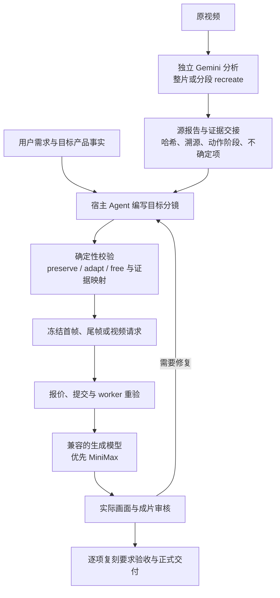

# Gemini 原视频理解与宿主目标分镜交接验收

日期：2026-10-18。状态：本地实现，尚未发布、部署、重启服务或更新已安装宿主 Skill。沿用已有 `main` 分支；保留工作区原有及并行修改。没有付费分析或生成。本记录只描述本次 Gemini 交接、复刻约束及相关回归；全量测试包含工作区其他改动。

## 职责与数据流

宿主可以使用 DeepSeek、GPT 或 Claude 编写目标计划。原视频理解固定要求实际配置的上游属于 Gemini；模型展示名称不能代替上游声明。宿主不会因为缺少视觉能力而替代 Gemini。纯文本宿主仍不能自行声称完成画面审核。

## 已实现

- `reference_analysis_get(section="handoff")` 提供报告 ID/内容哈希、模型和版本、原片/分段依赖、完整镜头状态及动作阶段、叙事节拍、相关证据、稳定索引的不确定项、覆盖缺口与相邻原镜头；支持分页和选定源镜头。报告内容仍为不可信数据，不能作为工具指令。
- 本地验证报告字节/哈希、账号归属、完成的分析作业及其输出、原片哈希/时长/音轨元数据。分段报告递归验证服务端合并记录和各段作业。上传一个写着 Gemini 的 JSON 不构成有效分析来源。逐次校验读取报告字节；原片依赖检查资产记录，不逐次重读整个视频。
- `plan.remake` 绑定源报告，记录产品事实、`preserve/adapt/free` 要求及证据来源。目标镜头保留独立 ID，补充目的、相机、动作阶段、验收条件与要求映射；支持拆分/合并原镜头。新创作镜头可以不引用原镜头。
- preserve/adapt 必须覆盖，adapt 必须说明改变原因。修改源报告、要求、产品事实或不确定项决策需要 `remake.changeReason`。已有复刻计划/正式项目不能通过删除合同或换成无绑定计划绕过校验。
- 相关未解释的不确定项、来源错误或覆盖缺口会阻断后续制作。`not_applicable` 需要理由，只表示目标无需该事实，不代表模型已经看清。未被目标引用的 free 要求不因原片无关未知项阻塞目标。
- 生成提示词由保存的目标计划统一编译。首帧使用起始状态，尾帧使用终态，视频携带动作阶段、复刻要求与验收条件。首帧不会被要求提前呈现动作完成结果。复刻任务不能用手写提示词覆盖丢弃约束。
- 准备记录冻结证据依赖；报价、提交、worker 执行、素材归属及正式交付检查重新验证依赖。源分析/计划变化需重新准备和验收。
- 云端准备保留并确认 `rikoko-remake-handoff-v1` 快照；缺失、替换、错误上游或摘要不一致会失败。云端获得的是明确标注的 **host_verified_snapshot**，不声称独立读取了宿主本地原片；默认不为准备请求上传原片/报告。
- 正式成片 `media_review(revisionId=...)` 增加 `requirementChecks`：每条 preserve/adapt 都需要实际判断、理由和 pass。fail/unknown 不能接受，旧记录缺少要求验收也不能使 `workspace_validate.finalReady=true`。
- capabilities、工具说明、MCP instructions 与仓库 Skill 已更新，引导宿主读取证据后编写目标分镜。新流程不引入内部自主导演，也不自动购买视觉审核。

## 回归发现并修复

1. 目标镜头可只填 sourceShotIds 却不绑定分析；已禁止。
2. preserve 被静默改成 free 或删除整份复刻合同；已要求变更理由并阻止解绑。
3. 新增无源镜头意外收到所有原镜头；已返回空源镜头列表并保留目标邻居。
4. 一个要求跨多源镜头时，错误地要求每个目标镜头重复全部源映射；已按目标镜头联合覆盖验证。
5. 首帧继承完成动作的验收文案；已分离三种生成阶段并检查模型类型。
6. 云端同步丢失复刻依赖、手写 prompt 移除目标约束；已阻断并覆盖测试。
7. 成片通用检查全通过但未逐项验收复刻要求；已补上正式交付门槛。
8. 新音轨校验影响旧分镜读取接口；严格音轨匹配已限定在新复刻交接链路，保留旧接口的读取兼容性。

## 验证

测试命令、原始日志和覆盖率保存在 `artifacts/remake-handoff-2026-10-18/`。分析与生成使用显式测试替身；媒体/渲染回归使用仓库现有本地 FFmpeg 路径。MCP 测试经过真正的内存 Client/Server 传输，云端测试经过请求序列化和公共服务校验。

- 用户随后明确选择：单独验收本次 Gemini 交接改动，并报告合并状态。本轮按该范围复验，不替代真实生成质量验收。
- 确认后的定向回归：7 个文件、**78 项测试全部通过**（`confirmed-focused.log`），覆盖本地/云端交接、MCP 往返、合并来源、跨账号、损坏报告、模型替换、映射、未知项、生成阶段、过期依赖与正式验收。已适配并行任务的结构化状态字段、默认制作范围和云端模型目录请求。
- 定向覆盖率：语句 86.29%、分支 81.44%、函数 88.37%、行 86.81%。范围为 `reference-handoff.ts`、`production-plan.ts` 和声明性 `remake.ts`，不是全仓库覆盖率。HTML 见 `artifacts/remake-handoff-2026-10-18/confirmed-coverage/`。
- 本轮重新执行 `pnpm typecheck` 通过（`confirmed-typecheck.log`）；此前旧 `imagePrompt/videoPrompt` 测试的 9 处类型错误已消除。`git diff --check` 通过，相关交接文件未发现冲突标记。
- 并行任务“修复 rikoko 出片保护缺口”已完成。两组改动共存在当前 `main` 工作区；本次没有创建分支、执行 Git 合并、提交或部署。按其 [整体验收记录](production-enforcement-2026-10-18.md)，当前整合代码的 77 个测试文件、585 项测试、类型检查与生产构建通过；全仓库行覆盖率 89.15%、分支覆盖率 83.92%。整体验证由该任务执行，本轮独立复验的是上述 78 项及类型检查。
- 历史全量日志 `full-test-final.log` 的 55 项失败来自并行改造过程中的过渡快照，不再代表当前状态；保留日志供追溯，不将其当作最终验收结论。

## 使用与兼容边界

1. 已安装宿主需更新 Skill、MCP 运行时并重新连接；官方模式还需更新云端运行时/模型目录。旧云端不能确认快照或 Gemini 上游时会明确拒绝，不能通过删字段降级。
2. 历史只写 sourceShotIds 的目标计划需迁移到绑定报告的 remake 计划，再重新准备。未引用原片的普通创作不需要 remake。历史低精度报告仍可读取，但不能作为新复刻交接依据。
3. 受 provider 提示词长度限制，过长计划必须人工精简或拆成多个目标镜头；系统不会截断动作阶段后继续生成。
4. schema、哈希、覆盖和逐项验收记录不能证明 Gemini 描述正确，也不能证明生成模型遵循了动作。产品事实、变更理由和画面判断仍由宿主/用户提供；不自动核实宿主视觉能力。
5. 本次未验证真实 Gemini 识别质量、MiniMax 成片质量、实际各宿主接图能力、线上部署和端到端付费恢复。不能把自动化通过当成复刻效果保证。后续质量验收应使用固定原片集，比较关键动作覆盖、目标产品一致性、状态连续性、要求漏失和返工次数。
