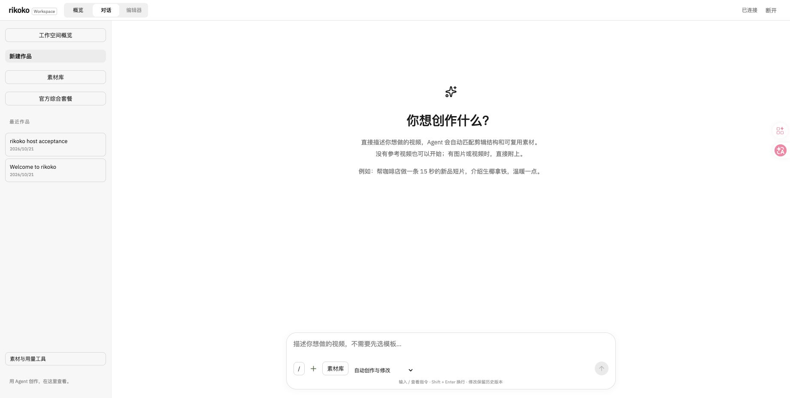
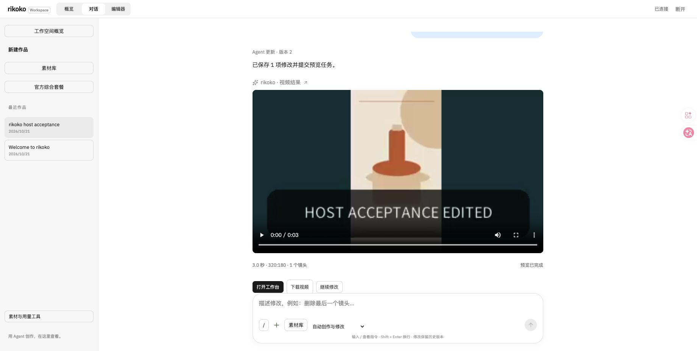
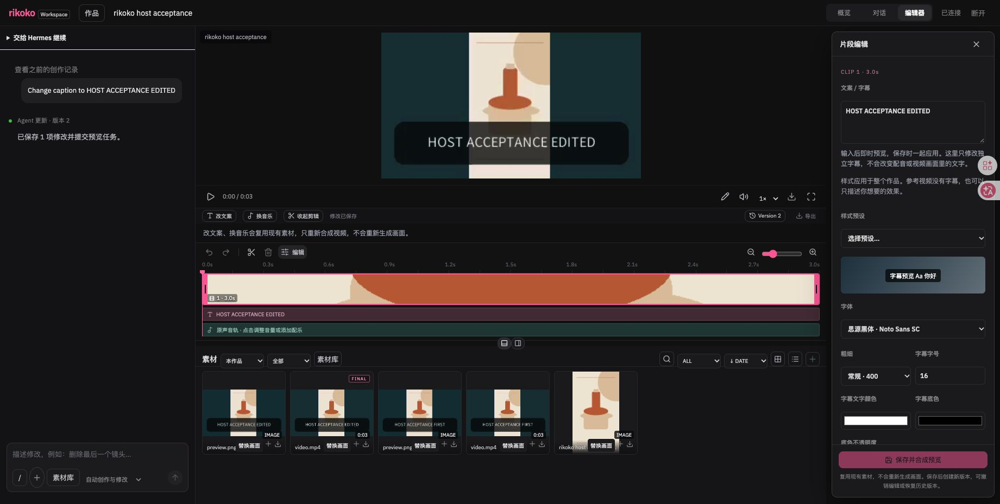
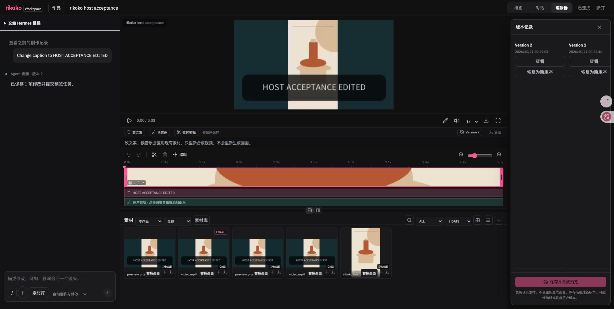

# rikoko 中文使用教程

从启动项目到导出第一条视频，再学习素材编排、字幕、声音和版本恢复。

适用版本：当前源码版（2026-10-21）。视频创作 MCP 统一称为 **rikoko**，新安装使用 `rikoko` MCP 连接名。截图来自隔离验收项目：原创商品插画、3 秒本地视频、两次字幕版本，无付费生成或用户私人素材。截图中的验收英文文案与下方教学示例不同；入口、编辑和版本操作相同。部分区域仍显示英文。

**推荐路径：启动服务 → 按第 7 节接入原 Agent → 在原对话创作和修改 → 按需点击工作台链接。** 用户始终使用 Agent 原有输入框；不自动弹出 MCP 窗口、注册卡片播放器或另开网页对话。第 2～6 节的网页操作用于主动打开工作台后的预览、精修与导出，也可独立使用。

## 目录

1. [选择使用方式](#1-选择使用方式)
2. [启动并连接工作空间](#2-启动并连接工作空间)
3. [做出第一条视频](#3-做出第一条视频)
4. [打开工作台并修改](#4-打开工作台并修改)
5. [用自己的图片和视频创作](#5-用自己的图片和视频创作)
6. [调整声音与配音](#6-调整声音与配音)
7. [在 Codex、Claude 或 Hermes 中使用](#7-在-codexclaude-或-hermes-中使用)
8. [使用与更新模板](#8-使用与更新模板)
9. [使用图片、视频和音频生成模型](#9-使用图片视频和音频生成模型)
10. [找回作品与恢复版本](#10-找回作品与恢复版本)
11. [常见问题](#11-常见问题)

## 1. 选择使用方式

项目有两个创作入口，共用同一工作空间中的作品、素材和版本。

| 入口         | 适合做什么                                | 如何进入                                               |
| ------------ | ----------------------------------------- | ------------------------------------------------------ |
| Agent 原对话 | 描述需求、让 Agent 编排素材、连续提出修改 | 安装 rikoko MCP 后，在 Codex、Claude 或 Hermes 中使用 |
| 网页工作台   | 直观看预览、调整时间线、字幕、画幅和声音  | 本地服务启动后打开浏览器                               |

Agent 对话是主要入口。只需原对话创作时，完成第 2.1 节启动后直接跳到[第 7 节](#7-在-codexclaude-或-hermes-中使用)，不必先登录网页。需要手动查看或编辑视频时，才点击 Agent 返回的工作台链接。

先分清两个操作：

- **剪辑与编排**：处理已有素材、文字和时间线，在本地用 FFmpeg 合成，不消耗官方模型 API 额度。
- **视频生成 / 图片生成 / 音频生成**：调用配置好的模型，需要服务凭据和相应预算，提交前显示报价。

宿主 Agent 的服务费用另计。项目和剪辑在本地处理，也不代表外部模型调用无需联网。

## 2. 启动并连接工作空间

### 2.1 当前可用的源码启动方式

需要准备：Node.js ≥ 22.19、pnpm 10.28.2、uv，以及支持 `libx264` 的 FFmpeg 和 ffprobe。下面的 `uv sync` 会准备 Python 3.12 环境。命令以 macOS / Linux / WSL 终端为例。

在终端进入项目根目录，也就是包含 `package.json` 的目录。如果路径有空格，给路径加引号。

首次运行：

```sh
pnpm install --frozen-lockfile
uv sync --project python --frozen --python 3.12
pnpm build
pnpm dev
```

看到 `rikoko: http://127.0.0.1:4310` 后，保持这个终端运行，在本机浏览器打开：

<http://127.0.0.1:4310>

以后日常启动通常只需在项目根目录运行 `pnpm dev`；更新源码或前端后，先重新运行 `pnpm build`。

**一行安装版的状态：**GitHub 发布版入口见仓库 README；已发布版本与当前工作区源码可能不同。本地候选包通过验收不代表已经发布。安装后以命令输出的本地地址为准，它会管理后台服务，无需手动保持 `pnpm dev`。升级、失败回退与中断恢复见[安装说明](../architecture/installation.md)。

### 2.2 首次登录网页

1. 点击右上角 **连接工作空间**。
2. 用本机文本编辑器打开项目内的 `.data/local-admin.key`，复制其中的完整内容。
3. 粘贴到 **工作空间 API Key**，点击 **连接并开始**。
4. 右上角出现 **已连接**，即可开始创作。

macOS 也可以在项目目录执行以下命令，将 Key 直接放入剪贴板：

```sh
pbcopy < .data/local-admin.key
```

这个 Key 是本地工作空间的访问凭据，请只粘贴到自己的工作台，不要发进对话、截图或共享文档。它与官方模型 API Key、fal 等供应商 Key 是不同凭据。

网页连接有效期为 24 小时；过期后重新连接，作品仍然保留。自定义 `DATA_DIR` 后，应从该目录读取 `local-admin.key`。正式安装版则位于安装目录的 `data/local-admin.key`。

### 2.3 认识页面

| 页面入口                | 用途                                     |
| ----------------------- | ---------------------------------------- |
| 对话 `/`                | 提交创作要求、查看方案和结果、继续修改   |
| 工作台 `/workspace`     | 预览、时间线、素材、片段编辑和版本记录   |
| 素材库 `/library`       | 用途分类、标签、收藏，并复用已有素材 |
| 素材与用量工具 `/tools` | 素材管理、单项配音、字幕处理、任务和用量 |
| 官方综合套餐 `/plans`   | 查看配置的官方套餐与余额信息             |

## 3. 做出第一条视频

这一例将制作一条 **9 秒、3 个镜头的竖屏文字短片**。画面为本地文字卡片，默认没有配音。

### 3.1 选择“剪辑与编排”

点击左侧 **新建作品**，再点击首页的 **从文案开始**。它会自动填写示例文案，并切换到 **剪辑与编排**。

也可以手动选择输入框下方的 **创作方式 → 剪辑与编排**，粘贴以下内容：

```text
用三段文字制作 9 秒竖屏短片。脚本：一杯咖啡，开启今天；把忙碌留在门外；让这一刻慢下来
```

这里的“脚本：”标记正文，分号分隔镜头。当前本地编排器会把这三句话分成三个镜头，每个约 3 秒。

**首页默认“自动创作与修改”。直接描述用途和内容，Agent 在后台匹配模板与已有素材，不需要用户选模板或上传参考视频；参见[模板与素材复用](模板与素材复用.md)。需要新增画面的付费生成仍单独确认费用。**



### 3.2 提交并应用方案

1. 点击输入框右下角的发送箭头，或按 Enter；Shift + Enter 可换行。
2. 页面显示 **编辑方案**，检查镜头数量、时长和“画面使用本地文字卡片”的说明。
3. 点击 **应用并生成预览**。
4. 等待任务从“等待处理 / 正在合成”变为 **预览已完成**。

显示方案时还没有生成视频；点击应用后才创建作品版本并提交渲染任务。

### 3.3 播放和下载

预览完成后，在结果卡片播放视频，检查三句文案。点击 **下载视频** 保存 MP4，或点击 **打开工作台** 继续编辑。



完成这一节后，你应该得到一份约 9 秒的 MP4，以及一个可继续修改的作品。

## 4. 打开工作台并修改

工作台桌面布局包括左侧助手、中间播放器与时间线、素材区，以及按需打开的右侧编辑面板。

### 4.1 修改第一段字幕

1. 在结果卡片点击 **打开工作台**。
2. 双击时间线中的第一个镜头，打开 **片段编辑**。
3. 在 **字幕** 文本框中改为：`今天，从一杯咖啡开始`。
4. 点击 **应用字幕**。
5. 点击 **保存并生成预览**。
6. 等待预览完成，再点击 **导出**。

**应用字幕只是修改当前草稿；保存并生成预览才会创建新版本。** 看到“未保存修改”时，先保存，再切换作品、刷新或关闭页面。

### 4.2 调整速度

在同一个面板找到 **成片速度**，选择 `2×`。第一段原本 3 秒，变速后约为 1.5 秒，整片从 9 秒缩短到约 7.5 秒。保存后，导出的 MP4 也会变快。

播放器上的临时播放倍速只影响观看；**成片速度**才会影响导出。成片变速支持 0.25～4×，镜头声音保持音高，背景音乐保持原速。



### 4.3 常用剪辑操作

| 想做什么             | 操作方法                                            | 注意事项                                                    |
| -------------------- | --------------------------------------------------- | ----------------------------------------------------------- |
| 裁掉镜头开头或结尾   | 双击镜头，填写“裁剪起点 / 裁剪终点”，点击“应用裁剪” | 时间相对于当前镜头；如保留 `0.5` 到 `2.5` 秒，得到 2 秒片段 |
| 用拖动方式裁剪       | 在时间线上拖动片段两端                              | 需要更精确时改用数值输入                                    |
| 把一个镜头切成两段   | 选中镜头，把播放头移到镜头内部，点击“分割”          | 分割点需在镜头内                                            |
| 删除镜头             | 选中后点击“删除片段”                                | 作品至少保留一个镜头                                        |
| 调整顺序             | 在片段编辑中点击“前移 / 后移”                       | 每次移动一个位置                                            |
| 改为横屏、竖屏或方形 | 在片段编辑的“画幅”中选择                            | 画幅影响整份作品；可选 1080P 等尺寸                         |
| 完整保留画面         | “填充方式”选择“适应画布”                            | 画幅不一致时可能留边                                        |
| 铺满整个画面         | “填充方式”选择“填满画布”                            | 可能裁掉边缘，不是自动人物跟踪                              |
| 调整字幕样式         | 改“字号 / 文字颜色”                                 | 这是整份作品的字幕样式                                      |
| 撤销刚才的编辑       | 点击时间线上的“撤销 / 重做”                         | 用于当前编辑草稿；已保存版本通过版本记录恢复                |

编辑完成后，统一点击 **保存并生成预览**，等待完成，再导出。

## 5. 用自己的图片和视频创作

### 5.1 上传并编排

1. 新建作品，选择 **剪辑与编排**。
2. 点击输入框左侧的 **＋**，选择图片或视频。
3. 检查文件清单，点击 **我有使用权限，上传**。
4. 等待文件显示在输入框上方，输入要求并发送。

例如，上传三张图片后输入：

```text
用这些素材制作 12 秒竖屏短片。脚本：新品到店；细节值得一看；欢迎来体验
```

查看方案，点击 **应用并生成预览**。第一遍编排后，在工作台核对素材顺序、字幕和时长，需要时用“前移 / 后移”调整。

单文件上限为 **100 MiB**，界面简写为 100 MB。常见图片包括 PNG、JPEG、WebP，视频包括 MP4、MOV、WebM；音频需能通过实际媒体校验。文件扩展名正确不代表内容一定有效。

当前本地编排会按素材和文案建立镜头，短视频素材可能缩短对应镜头，实际总时长以预览结果为准。它不会自动理解视频内容并挑出高光片段。

### 5.2 给已有作品换画面

打开已有作品，在对话中上传一张新图片，选择 **剪辑与编排**，输入：

```text
第一个镜头换成这张图
```

确认方案后应用。这个操作会替换目标镜头的画面，并保留原有声音；请只附上一份要使用的替换素材。

在工作台素材区，也可以使用 **添加到时间线**，把素材作为新片段加入。音频淡入淡出、配乐和音量调整见下一节。

### 5.3 可直接复制的网页修改指令

先打开作品、选择“剪辑与编排”。建议一次发送一个明确动作：

```text
字幕大一点
```

```text
第二个镜头字幕改成：现在开始，刚刚好
```

```text
第一个镜头保留 0 到 2 秒
```

```text
第二个镜头移到开头
```

```text
改成横屏
```

```text
删除最后一个镜头
```

这些是当前本地编排器支持的明确指令。“做得更高级”“自动找最精彩的片段”等自由要求，需要更多上下文或额外模型能力；页面只请求补充信息时，作品尚未修改。

## 6. 调整声音与配音

### 6.1 原声与背景音乐

1. 打开工作台，选中要修改的镜头。
2. 双击镜头，或点击时间线下方的 **原声音轨 · 点击调整音量或添加配乐**。
3. 调整 **原声音量**：0% 为静音，100% 为原音量，最高 200%。
4. 需要配乐时，先上传音频，再在 **背景音乐** 中选中它，并调整 **配乐音量**。
5. 保存并生成预览，试听后导出。

原声音量针对所选镜头，背景音乐针对整份作品。纯文字或图片镜头默认没有原声，调高音量不会自动产生声音。

### 6.2 淡入淡出与音量关键点

对有声音的镜头，可以先试一组简单设置：

- 淡入：`0.4` 秒。
- 淡出：`0.4` 秒。
- 点击 **应用淡入淡出**，再保存。

淡入和淡出的总时长不能超过镜头长度。**应用淡入淡出会替换该镜头已有的音量曲线。**

需要局部降低声音时，把播放头移动到相应位置，在声音面板添加音量点，再调整每个点的百分比。关键点之间线性过渡；百分比乘以“原声音量”，例如原声音量 150%、关键点 50%，该时刻约为原始音量的 75%。

波形显示源音频的强弱概览。看到“此镜头暂无声音素材”时，先确认选中的视频或音频确实包含声音。

### 6.3 只生成一段中文配音

1. 回到 **对话**，点击左侧 **素材与用量工具**。
2. 在工具页切到 **字幕与声音**，找到 **单项配音**。
3. 输入配音文字，语言选择 **中文**。
4. 点击 **生成独立音频**，在任务完成后试听或下载。

音频会保存到素材库。后期配音默认采用 ElevenLabs Eleven v3，需要可用的云端档案并确认本次报价；不再提供本地系统配音。视频生成时优先保留模型原生声音。给镜头绑定或替换配音，可让已连接的 Agent 指定目标镜头和音频素材；独立音频生成不会自动改写作品。

### 6.4 已有字幕与自动识别

工作台直接编辑的“镜头字幕”是你填写的文字，不是自动识别结果。

工具页的 **单项字幕** 提供：

- **烧录已有字幕**：选择视频，填写带时间戳的转录 JSON，再创建任务。当前输入框不是直接上传 SRT 的入口。
- **WhisperX 转录**：需要单独配置 WhisperX 及本地模型，默认源码环境不保证可用。

第一次使用时，先用镜头字幕完成创作；需要自动识别时，再按能力状态配置相应环境。

## 7. 在 Codex、Claude 或 Hermes 中使用

### 7.1 接入客户端

源码版先保持 `pnpm dev` 运行，在另一个终端进入同一项目目录，根据实际客户端**选择一条**安装命令：

```sh
pnpm clients install codex
```

```sh
pnpm clients install claude-code
```

```sh
pnpm clients install claude-desktop
```

Hermes 需要在它实际运行的机器上配置，且该机器已有 Hermes 配置：

```sh
pnpm clients install hermes
```

安装后重启或重载客户端 MCP 连接。Codex 可在 MCP 设置中重连；Claude Code 可检查 `/mcp`；Hermes 可使用 `/reload-mcp`。当前自动处理 Claude Desktop 配置的路径面向 macOS。

可以运行相应检查，例如：

```sh
pnpm clients doctor codex
```

macOS 源码接入使用 Keychain 保存客户端专用 Key；其他系统的秘密环境注入、远程 Hermes 和正式安装版差异，见[三端接入说明](../../examples/clients/README.md)。这些检查验证连接器，不代表每个真实客户端的界面和媒体展示都已验收。

### 7.2 第一次对话

把下面这段话发给已连接 rikoko MCP 的 Agent：

```text
使用 rikoko 制作一条 9 秒竖屏短片。
只使用本地文字卡片，不调用付费生成模型。
分成三个镜头，每个 3 秒：
1. 一杯咖啡，开启今天
2. 把忙碌留在门外
3. 让这一刻慢下来
在当前对话告诉我状态，完成后只给我一个工作台链接。
不要打开 MCP 窗口、嵌入播放器或自动打开网页。
```

继续修改可以说：

```text
继续修改刚才这份作品：把第一个镜头字幕改成“今天，从一杯咖啡开始”，
把它的成片速度改为 2 倍，保留其他镜头，保存新版本并返回工作台链接。
```

Agent 使用自身的理解能力调用普通 MCP 工具，不要求额外配置网页创作模型。默认回复如“已完成，保留了其他镜头。[打开工作台]”，只有用户点击链接时才打开工作台。继续修改直接在原 Agent 输入框里说即可。切换到工作台编辑后再回到对话，要求 Agent 先读取作品最新版本，再继续修改。

从旧版更新后，需要重启服务并重载 Agent 的 MCP 连接，清除旧的工具界面声明。旧对话里已经出现的卡片可能仍留在历史消息中；新的工具调用不再请求卡片。

### 7.3 让 Agent 使用本地文件

把有权使用的素材放入工程的 `media-inbox/`，并告诉 Agent 文件位置。例如：

```text
使用 rikoko，把工程 media-inbox 中的 product.mp4 导入素材库。
这份视频由我们拍摄，我确认有权使用。
制作一份保留前 6 秒的视频，保持原声，使用竖屏画幅，完成后给我工作台链接。
```

默认文件导入允许工程的 `media-inbox/` 和 `artifacts/`；macOS Hermes 安装配置还包含 `~/Library/Application Support/Hermes/composer-images/`。旧的默认 Hermes 配置可重新运行 `pnpm clients install hermes` 升级，再执行 `/reload-mcp` 或重启 Hermes。其他附件目录由操作者通过 `VIDEOWORKBENCH_IMPORT_ROOTS` 配置，自定义白名单不会被安装器自动扩展。`FORBIDDEN` 提示会列出当前允许的目录和恢复方法；可将所选素材复制到可用目录后使用新路径导入。不要开放整个用户主目录。附件只出现在聊天窗口、但宿主未提供可访问路径时，连接器无法自动读取它。

任务完成后，Agent 在原对话交付视频和相关内容。配置了导出目录的 Codex/Hermes 会自动保存附件；其他宿主使用返回的媒体链接，用户也可以明确要求只返回链接。缺少必需素材时，Agent 保存请求后提出具体问题；上传素材后继续同一请求，不必重复要求。文件导出工具可重试保存，不会重新生成。不要把另一台电脑的绝对路径当成本机可用文件。

## 8. 使用与更新模板

模板是 Agent 的内部创作资源，不是开始创作前必须浏览的页面。

1. 直接输入“帮咖啡店做一条 15 秒新品短片，主打生椰拿铁”。
2. Agent 自动检索结构与可复用素材，填入文案，并保留用户指定的时长和比例。
3. 有合适内容时直接本地合成预览；只有真正缺少内容时才补充要求，新增付费生成仍需报价确认。
4. 在对话继续修改，或打开工作台精修。满意的画面留在素材库供后续复用。

配置了云端模板源时，可以让 Agent 通过 `template_sync` 更新目录。详见[模板与素材复用](模板与素材复用.md)。

**模板只在手动更新时同步。** 已有作品固定使用创建时的模板快照，新模板不会自动覆盖你的剪辑。模板更新和本地渲染不消耗官方模型 API 额度。

即使未配置云端模板源，也有 9 个内置模板可用，包含软件功能介绍、前后变化和用户评价。云端模板更新失败时，内置模板和已有素材仍可使用。配置方法见[模型服务说明](../architecture/model-services.md#模板更新独立配置)。

## 9. 使用图片、视频和音频生成模型

这一节适用于管理员已经配置模型凭据、启用模型并设置预算的工作空间。没有配置时，可以继续使用本地编辑流程。

### 9.1 生成流程

1. 在对话输入框下方选择 **图片生成 / 视频生成 / 音频生成**。
2. 选择一个可用模型，查看其规格说明。
3. 输入提示词并发送，例如视频提示词：

   ```text
   清晨的咖啡店，一杯热咖啡放在木质桌面上，窗边自然光，镜头缓慢推进。
   ```

4. 等待报价，核对模型、规格、费用来源与金额。
5. 接受本次费用后点击 **确认并生成**。
6. 结果完成后，可 **下载**、**继续剪辑**，或 **打开工作台**。

当前这个生成入口使用文字提示。上传的图片或视频保留在素材库，**不会自动成为图生视频、首尾帧或参考视频输入**。

### 9.2 费用从哪里扣

| 模式     | 凭据与配置                                      | 费用来源                                  |
| -------- | ----------------------------------------------- | ----------------------------------------- |
| 官方 API | 每位用户自己的官方 Key；安装版使用预设服务地址  | 官方 API 额度                             |
| 自有服务 | 在 config 中配置连接；当前适配 fal 和 Replicate | 自己的供应商账户，本地 Key 仍检查预算上限 |

自有连接通过配置文件管理，当前没有网页中的供应商设置表单。模型配置与示例见[模型服务说明](../architecture/model-services.md)。源码运行不会自动加载 `.env`，环境变量需由启动进程注入；改完配置后重启服务。

首次签发的客户端专用 Key 默认付费预算为零。已填模型 Key 但无法生成时，应检查模型是否启用、费用上限是否确认，以及客户端 Key 的预算。

套餐页只有在运营方配置真实购买入口后才有可用购买链接。当前实现不包含完整的支付回调与自动充值流程，不应把看到套餐页理解成支付已经开通。

## 10. 找回作品与恢复版本

### 10.1 继续上次的作品

重新启动服务，连接网页，在左侧 **最近作品** 中选择原作品。在工作台中可点击顶部 **作品** 切换。

源码版默认数据保存在项目的 `.data/`：

- `.data/db`：作品、版本、任务等记录。
- `.data/assets`：导入素材与输出文件。
- `.data/host-media/`：通过 stdio 交付给宿主的本地媒体副本。

关闭浏览器不会删除已保存的作品。要继续后台任务，服务进程仍需运行。停止源码服务时，在运行 `pnpm dev` 的终端按 Ctrl+C；备份前先等任务完成、正常停止服务，再复制完整数据目录。Key 文件也在其中，备份应妥善保管。

### 10.2 恢复某个旧版本

1. 在工作台点击 **Version N / 版本**。
2. 找到目标版本，点击 **查看** 检查内容。
3. 想继续使用这一版时，点击 **恢复为新版本**。
4. 等待预览完成，然后继续编辑或导出。

恢复会新增一个版本。例如先有版本 1、版本 2，恢复版本 1 后得到版本 3，原历史仍然保留。



如果提示版本冲突，先保存自己要保留的修改说明，再读取最新作品或刷新并重新应用修改。这通常表示另一个页面或 Agent 已经保存了更新。

## 11. 常见问题

| 遇到的问题                     | 优先检查与处理                                                                                                                                            |
| ------------------------------ | --------------------------------------------------------------------------------------------------------------------------------------------------------- |
| 网页打不开 / `Failed to fetch` | 确认服务终端仍在运行，并使用它输出的地址。源码默认端口是 4310，安装版可能使用其他端口                                                                     |
| `EADDRINUSE` / 提示端口占用    | 查找原来的服务终端，使用现有实例，或正常停止后重启；不要同时打开同一 `.data/db`                                                                           |
| 打开页面看不到新功能           | 更新源码后重新 `pnpm build`，重启服务并刷新页面；MCP 客户端也需重载工具清单                                                                               |
| Key 无效或登录失效             | 使用当前实例数据目录里的本地工作空间 Key；不要填模型 Key；超过 24 小时可重新连接                                                                          |
| 发送按钮不可用 / 暂无可用模型  | 做本地编辑时切到“剪辑与编排”；做模型生成时检查模型配置与预算                                                                                              |
| 只显示补充问题，没有视频       | 网页本地编排器尚未获得可执行方案；提供“脚本：…”或上传素材，使用明确指令                                                                                   |
| 文字样片没有声音               | 文字卡片默认没有配音；上传音频或通过单项配音生成声音素材                                                                                                  |
| 中文是方框或缺字               | 配置包含中文字形的本地字体，通过 `MEDIA_FONT` 指向字体文件，然后重启服务并重新渲染                                                                        |
| FFmpeg 或 Python 启动失败      | 检查 `ffmpeg`、`ffprobe` 和 `uv` 是否可用；完成 `uv sync --project python --frozen --python 3.12`，确认 FFmpeg 支持 libx264                               |
| WhisperX 转录不可用            | 需要额外安装和配置识别环境；可先编辑文字字幕或烧录已有时间戳字幕                                                                                          |
| 云端模板更新失败              | 检查真实模板源地址与网络；内置模板、已有作品和素材仍可使用                                                                                                          |
| 修改看得到，导出还是旧内容     | 先点“应用字幕”等局部应用按钮，再点“保存并生成预览”；等当前版本任务完成后导出                                                                              |
| 任务显示“等待配置”             | 查看任务错误，补齐缺少的本地工具或外部服务配置后再重试                                                                                                    |
| 付费任务显示“等待核对”         | 可能提交结果不明；保留原任务，让管理员查询和核对，避免再次购买同一生成                                                                                    |
| 手机打不开电脑上的工作台       | 手机的 `127.0.0.1` 指向手机本身；远程访问需要管理员配置可达的 HTTPS 地址与登录方式，见[三端接入说明](../../examples/clients/README.md#手机远程与能力边界) |

## 本教程的验证范围

2026-10-12 使用隔离的本地临时工作空间，按本文核心步骤实际完成：三段文字创建、FFmpeg 合成、MP4 下载、字幕修改、2× 成片速度、保存新版本、刷新后保留修改，以及恢复历史版本。文中四张截图来自这次操作。

首个样片为 3 个镜头、约 9 秒；第一镜头设为 2× 后整片约 7.5 秒，恢复为新版本后回到约 9 秒。本次没有调用付费模型。客户端接入、模板服务、云端配音和外部生成部分依据当前实现与配置文档说明，不代表已在你的运行环境全部验证。

更多配置：[项目首页](../../README.md) · [安装说明](../architecture/installation.md) · [客户端接入](../../examples/clients/README.md) · [模型服务](../architecture/model-services.md)。
